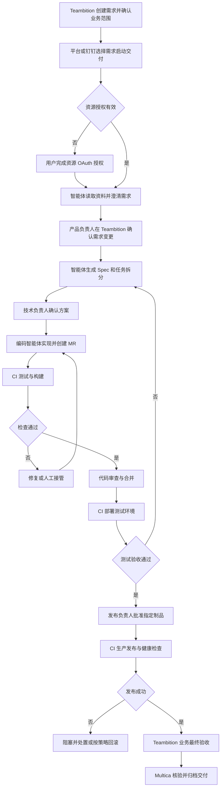
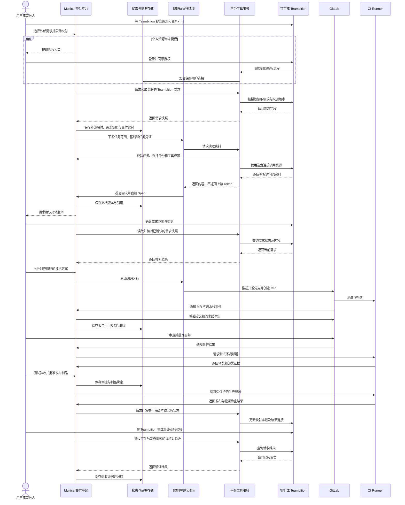
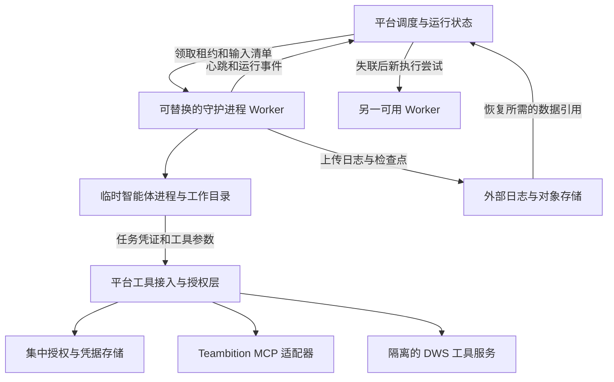

# 团队交付平台设计目标与规划

状态：设计草案。更新日期：2026-10-20。

基于 Multica 建设团队内部使用的 AI 研发交付平台，参考 DeliveryAI 的需求交付、角色协作和证据追踪方式。首期以 Teambition 管理需求及业务进度，Multica 负责执行与交付治理，GitLab 承载代码和 CI/CD，钉钉提供通知与资源访问入口。复用 Multica 的任务、项目、智能体和运行管理，补充交付流程、审批、个人授权及发布治理。

本文记录目标架构和阶段范围，不代表相关能力已经实现。现有能力的源码核查基线为 `master` 提交 `1242fedc9`；实现前应重新确认对应代码。

## 设计目标

- 将需求、Spec、代码、测试、部署与验收关联到同一轮交付，关键决定可以追溯。
- 由平台自动衔接执行，由有权的人员确认需求、方案、代码和发布。
- 用户通过平台或钉钉查看进度、处理待办、补充信息和接管异常。
- 智能体按明确的代码基线、任务范围和外部授权工作，避免不同用户身份混用。
- 流程在服务重启、外部回调重复、执行失败和人工退回后可以恢复。

首期聚焦单组织、Teambition 单一需求来源、单仓库交付和固定流程模板。GitLab Issue 与 Jira 需求接入留作后续扩展。跨组织 SaaS、自由拖拽流程设计器、复杂多仓库并行编排及自动修改生产数据不在首期范围。

## Teambition 与执行平台的边界

Teambition 是需求目标、范围、优先级、业务负责人和总体进度的权威来源。Multica 的任务（`issue`）定位为可分派、可验收的执行工作项，其下保留一次或多次智能体运行；不在 Multica 重建独立的业务需求管理体系。

| 数据 | 权威来源 | 同步方式 |
| --- | --- | --- |
| 需求描述、范围、验收标准与优先级 | Teambition | 读取后保存快照；变更展示差异并评估影响 |
| 需求总体进度与业务最终验收 | Teambition | Multica 按映射申请更新进度；最终完成须依据有权人员的业务验收 |
| Spec、执行任务、节点审批与证据 | Multica | 向 Teambition 回写摘要、阻塞原因和结果链接 |
| 提交、MR、流水线与制品 | GitLab | Multica 核验后关联到对应交付与需求 |

关系为一条 Teambition 需求对应多轮交付，每轮交付包含多个 Multica 执行任务，每个任务包含多次运行。维护服务实例、外部项目与需求 ID、内部交付 ID、来源版本或内容摘要，以及最后同步状态；不得仅依赖标题或可变链接匹配。

首期通过用户选择 Teambition 需求或提供其链接启动交付。平台和钉钉可以发起关联执行，但不生成另一份独立需求；需求范围修改回到 Teambition，技术讨论与执行决定保留在 Multica。

接入适配器负责读取需求、检测变更、关联执行以及回写进度。优先验证官方 MCP 的字段、工具与授权覆盖，事件订阅单独确认；没有可用事件通道时采用受控轮询和定期对账，不能把 MCP 调用能力视为 Webhook 能力。DWS 的其他钉钉资源按需扩展，不作为首期需求同步的必需依赖。

状态映射按 Teambition 项目配置，不硬编码状态名称。多个执行任务的结果汇总为需求进度：开始执行、阻塞、待测试验收或待发布等状态按规则回写；单个任务完成、MR 合并和部署成功均不能单独关闭需求。业务验收由有权人员在 Teambition 完成，Multica 核验后归档；若接口无法确认验收人或对应版本，则增加平台侧确认，不能仅凭状态字段归档。

同步采用字段归属、幂等键、来源标记和版本检查，防止回写触发循环或旧事件覆盖新状态。外部需求删除、取消、权限撤销或范围变更时进入待核查状态，按策略暂停后续执行并通知负责人，不自动删除交付证据。外部同步失败记录为待同步，与真实执行结果分开显示。

## 当前底座与能力缺口

| 领域 | 可复用能力 | 待补强内容 |
| --- | --- | --- |
| 团队协作 | 工作区、项目、任务、评论和成员角色 | 项目交付职责、审批权限与待办交接 |
| 需求接入 | 可复用任务与项目关联结构 | Teambition 需求映射、快照、变更检测、状态汇总与对账 |
| 流程 | 项目工作流、状态负责人、节点指令与交接 | 交付实例、版本快照、服务端门禁与退回规则 |
| 智能体 | CLI 提供方、守护进程、运行日志与重试机制 | 外层执行隔离、任务范围、资源预算与凭据边界 |
| GitLab | MR 关联、合并状态与 CI 状态展示 | 精确提交校验、制品关联、部署、验收及回滚 |
| 钉钉 | 机器人接入、账号绑定、消息与任务入口 | 用户资源 OAuth、交付待办与状态同步 |
| MCP | 配置合并、插件工具审批和守护进程代理 | 用户连接管理、授权身份路由与平台侧代理 |
| 产物 | 任务附件、评论和运行记录 | 按版本关联的结构化交付证据 |

源码中的 OAuth 协议工具函数并不等于可用的用户授权产品：旧插件 OAuth 表已在后续迁移中删除，未发现完整的通用 MCP 用户授权业务链路。现有 Composio 连接使用智能体所有者身份，而非随任务发起人切换；新接入不能直接沿用这个身份策略。

## 角色协作

产品与业务角色在 Teambition 管理需求，研发角色在关联的 Multica 执行任务和交付实例中协作，通过摘要及链接保持上下文。业务角色与工作区的 `owner`、`admin`、`member` 分开建模；平台管理员不自动获得业务审批或发布权限。

| 角色 | 主要职责 | 交接产物 |
| --- | --- | --- |
| 需求提出人 | 提交目标、资料，回答澄清问题 | 需求来源与业务说明 |
| 产品负责人 | 确认范围、优先级与验收标准 | 已确认的需求版本 |
| 技术负责人 | 审阅 Spec，确定技术边界和任务分工 | 已确认的 Spec 与执行任务 |
| 开发人员或编码智能体 | 实现、验证、提交代码并修复问题 | 提交 SHA、MR、运行记录 |
| 代码审查人 | 审查实现和风险，批准或要求修改 | 对具体代码版本的审查结果 |
| 测试验收人 | 核验测试报告并验证测试环境 | 验收结果与缺陷记录 |
| 发布负责人 | 核对制品、环境、检查结果和回滚方案 | 对指定制品及环境的发布批准 |
| 业务负责人 | 确认上线效果符合业务目标 | 最终验收结论 |
| 平台管理员 | 管理成员、集成、执行节点与模板 | 可用的交付基础设施 |

同一人可以兼任多个角色。项目可要求关键操作的执行人与审批人分离，并设置审批替补和超时升级负责人。评论用于讨论；正式批准必须通过有权限校验、绑定版本的审批操作完成。

## 用户交互流程

首次使用时，管理员配置 Teambition 项目与状态映射、GitLab、钉钉机器人、角色和执行节点；成员登录平台并绑定钉钉身份，另行完成 Teambition 资源 OAuth 授权。项目同步使用明确配置的连接，不隐式借用管理员或智能体所有者的个人授权。

以根据钉钉资料新增业务功能为例：

图中为主要路径。需求、Spec、代码审查均可退回；退回时产生新版本或新执行尝试，保留历史记录，并重新检查受影响的批准。用户从需求详情和待办中心处理这些交接，钉钉提供通知及跳转入口。

## 服务职责与数据流转

沿用 Go、PostgreSQL 和现有 Web/Desktop 共享包结构。首期采用模块化后端；工具服务可以同部署，但须具有受控凭据和进程边界。

| 环境 | 职责 | 凭据边界 |
| --- | --- | --- |
| 平台服务 | 身份、权限、交付状态、调度、审批、证据和通知 | 平台集成及存储凭据 |
| 平台工具服务 | 用户授权、DWS 或官方 MCP 调用、工具限制及审计 | 钉钉用户 Token 或限定的应用授权 |
| 智能体执行环境 | 无持久状态的守护进程调度本机临时运行，执行分析、Spec、编码及开发验证 | 短期任务凭证、临时模型授权及限定的仓库开发凭据，不保存用户长期登录态 |
| CI 环境 | 确定性检查、构建、部署及健康检查 | 制品与对应环境的部署凭据 |

图中资源授权是抽象步骤：官方 MCP 的浏览器回调和 DWS 的设备授权轮询应由各自适配器实现，不能假设两者具有相同回调方式或共享 Token。GitLab 审批能力须按实际版本与许可证验证，必要时采用人工合并和受保护流水线。

## 交付模型与流转规则

Teambition 需求是业务入口，Multica 任务（`issue`）是执行工作项，智能体的一次执行称为运行（API 中为 `task`）。新增对象是概念模型，表名、字段和 API 在详细设计中确定。

| 对象 | 核心数据 |
| --- | --- |
| 外部需求映射与快照 | Teambition 实例、项目与需求 ID、来源版本或摘要、范围、验收标准、同步状态 |
| 交付实例 | 外部需求引用、需求快照、流程版本、仓库、基准 SHA、多个执行任务引用 |
| 节点实例 | 输入版本、负责人、执行方式、状态、进入与退出条件 |
| 执行尝试 | 关联运行或 CI、输入快照、结果、失败原因、重试关系 |
| 证据 | 类型、来源、所属节点和尝试、内容摘要、存储引用、对应版本 |
| 审批 | 审批人、权限依据、对象版本、结论及失效原因 |
| 用户连接 | 工作区、平台用户、服务、外部身份、授权范围、加密凭据和有效状态 |
| 外部事件 | 来源、去重键、目标交付、处理状态与重试记录 |

基本约束：

1. 交付实例固定需求、流程和代码基线，流程模板更新不静默改变运行中的实例。
2. 节点转换在服务端统一检查，网页拖动、CLI、智能体调用和 Webhook 均不能绕过门禁。
3. Spec 审批绑定文档版本，代码检查绑定提交 SHA，发布审批绑定制品摘要和环境。
4. 输入变化时按依赖关系使受影响的证据和批准失效；重新执行保留原记录。
5. MR 合并只表示代码合入，生产发布成功且业务验收通过后才表示交付完成。
6. 日志用于排错，结构化证据用于验收；区分智能体自述与 CI 等系统生成的结果。
7. 范围扩展形成需求新版本或后续需求；实现缺陷回到开发节点，避免所有返工都重新澄清。

## 身份与外部资源授权

每次调用区分发起人、责任人、外部执行身份和审批人。钉钉机器人 AppKey/AppSecret 标识应用；钉钉账号绑定确定用户映射；个人资源 OAuth 授权确定可访问资源，三者不能互相替代。

| 授权模式 | 场景 | 规则 |
| --- | --- | --- |
| 用户委托 | 个人有权访问的文档、日历或项目资源 | 固定委托用户与连接，不随当前负责人变化 |
| 项目服务身份 | 仓库开发、团队共享资源与通知 | 明确授予项目使用，不作为个人授权失败的回退 |
| CI 身份 | 制品与部署 | 按环境收窄，生产凭据不进入编码运行 |

智能体只向工具服务提交工具名与业务参数。工具服务从可信任务上下文确定用户，拒绝智能体自选任意 `user_id` 或连接。委派运行继承受限委托上下文；无人发起的定时任务必须预先配置服务身份或明确授权，不能猜测当前用户。

官方 Teambition MCP 与 DWS 作为独立接入适配器：

- 官方 MCP 已提供资源及授权服务器元数据，包括用户 scope、授权码、PKCE 和刷新能力；仍需验证客户端注册、完整授权、工具调用与授权失效行为。
- DWS 覆盖钉钉多个资源域，支持用户登录及设备授权，也存在应用身份命令。逐项核对工具身份，不能把所有命令都视为用户委托；通用 `dws api` 使用应用级 Token。
- DWS 由受控工具执行服务调用，按用户隔离配置和登录态。`DWS_CONFIG_DIR` 仅提供目录选择，不是安全边界；不得通过共享进程用户或挂载暴露其他用户凭据。
- DWS 的设备或系统密钥保护需要验证服务器部署、持久化和故障恢复方式，不能直接复制个人电脑登录文件作为生产方案。
- 凭据只在受控服务内解密使用；日志、工具响应和智能体配置不返回上游 Token。授权撤销或失效时暂停相关步骤，通知用户重新授权。
- 平台检查工具、资源范围和写操作规则。若智能体仍可直接运行带完整凭据的 CLI，将绕过这些限制，因此执行环境不挂载工具服务的登录态。

个人资源还存在内容传播边界：用户能读取资料，不代表项目所有成员都能读取。保存资料引用与快照时标记可见范围，只给获准的运行和成员提供内容；钉钉群通知默认只发状态及受控链接，避免全文泄露。

### 钉钉凭据不下发到守护进程

首期采用平台代理调用：钉钉 Access Token、Refresh Token 和应用 AppSecret 不下发到智能体或其守护进程。守护进程仅获得平台签发的短期任务凭证，通过工具接入与授权层调用资源；DWS 登录态也只保存在隔离的工具服务中。用户授权无需随 Worker 扩缩容或故障恢复迁移。

| 凭据或授权状态 | 持有方 | 用途 |
| --- | --- | --- |
| 短期任务凭证 | 守护进程及当前运行的工具客户端 | 访问平台工具入口，绑定运行、执行尝试、有效期和允许范围 |
| 钉钉 Access Token 与 Refresh Token | 平台凭据存储与 MCP 适配器 | 代表选定用户访问上游 MCP，集中刷新与撤销本地连接 |
| 钉钉应用凭据 | 平台集成或工具服务 | 执行明确授权的应用身份操作，不作为个人授权的回退 |
| DWS 用户登录态 | 隔离的 DWS 工具服务 | 在所选用户的配置和系统保护环境下执行允许的命令 |

调用链路如下，接口名称在详细设计中确定：

1. 平台创建运行时固定委托用户、连接引用和权限范围，将工具网关地址及短期任务凭证注入工具客户端配置，不写入提示词。
2. 工具客户端提交工具名、业务参数和任务凭证。平台检查凭证、运行状态、租约、执行代次和当前权限，从可信记录解析身份，不能由调用方任意指定用户。
3. MCP 适配器在服务端获取或刷新该连接的 Token 并调用 Teambition；DWS 适配器在隔离工具环境中执行，不向 Worker 挂载其配置目录。
4. 网关返回工具结果并记录调用人、执行身份、目标和结果，过滤凭据及敏感错误内容。上游仍按该身份检查实际资源权限。
5. 取消运行、租约过期或连接被撤销后，拒绝后续调用；Token 失效且无法刷新时进入待授权状态，不切换为管理员或智能体所有者身份。已经发出的请求和已完成的副作用需要单独对账，不能靠撤销凭证撤回。

平台不提供让智能体领取钉钉明文 Token 的通用接口。只有未来确需执行节点直连上游、且平台代理无法满足时，才单独评审凭据下发方案；这会扩大信任边界，并需要重新设计刷新、撤销、审计和清理，不作为首期能力。

不下发 Token 只保护凭据，工具返回的业务内容仍会进入智能体上下文；资源范围、内容可见性和日志脱敏继续按前述规则执行。

## 执行与运行保障

### 无持久状态的守护进程

目标是把守护进程改造成可替换、可横向扩展的执行 Worker。运行队列、身份映射、授权连接、日志、会话检查点与恢复决策由平台或外部存储管理，不依赖某台机器的本地数据库、个人 HOME 或长期登录态。这是目标改造，不代表现有 Multica 守护进程已经满足该要求。

无持久状态不表示运行时没有状态：守护进程仍管理当前进程、租约、连接和临时工作目录，但这些内容不是唯一的业务记录。丢弃节点后，平台能基于已确认保存的数据创建新的执行尝试。

| 数据 | 持有位置 | Worker 规则 |
| --- | --- | --- |
| 排队任务、交付节点和运行结果 | 平台数据库 | 通过接口领取与上报，不以本地队列为准 |
| OAuth Token、DWS 用户登录态 | 平台凭据存储与受控工具服务 | 不下发到守护进程，不挂载用户授权目录 |
| 身份与工具范围 | 平台运行记录 | 使用绑定运行和执行尝试的短期凭证，不接受任意用户切换 |
| 仓库、模型及 CLI 访问授权 | 平台受控分配或代理 | 如 CLI 必须持有凭据，仅临时注入运行隔离目录并在结束后清理；不依赖人工登录某台 Worker |
| 输入、skill 和配置 | 版本化清单与外部存储 | 执行时加载固定版本，缓存可丢弃 |
| 日志、输出与恢复检查点 | 外部存储及平台索引 | 增量上传，平台确认后才作为可恢复数据 |
| 源码 checkout、工具缓存和临时文件 | 本机临时目录 | 可重建；需要保留的修改必须提交或上传检查点 |

运行协议需要补充以下约束：

1. Worker 以部署注入的机器身份或工作负载身份注册并声明能力，按能力与信任域调度。机器身份独立于用户委托身份，不依赖手动登录或本地永久注册文件。
2. 平台原子地授予运行租约和单调递增的执行代次。心跳续租、工具调用、日志与结果上报都携带当前尝试标识；拒绝旧代次推进状态。新增尝试复用现有运行模型，不引入并行的第二套运行生命周期。
3. Worker 无法续租时在安全截止时间前停止运行；平台在租约失效后撤销旧任务凭证，再根据已保存检查点和副作用核查结果决定重调度。
4. 租约无法撤销已经发生的外部操作。工具网关在每次调用时检查租约；Git 推送、MR 创建和部署等操作通过受控代理或执行端并发约束收敛影响，超时后先对账，不能宣称天然保证只执行一次。
5. 日志和检查点记录序号、摘要及确认位置，允许去重上传。节点故障可能丢失未确认的数据；重要输出应先持久化，再上报完成。上传时排除凭据和含敏感信息的 CLI 配置。
6. 服务更新时 Worker 先停止领取新运行，再等待完成或按协议取消；平台保留失败和取消原因。正常清理临时目录，异常退出的容器或卷由回收机制销毁。

恢复是从固定输入或最近有效检查点启动新的进程，不承诺任意编码 CLI 会话无缝迁移。首期优先支持节点重新执行及 Git/文件检查点；CLI 原生会话恢复仅在其格式、版本、敏感数据与跨机器可移植性验证后启用。

DWS 自身的授权持久化属于工具服务的状态，不能为了让守护进程无状态而丢弃。其设备密钥和存储迁移问题由 DWS 适配器解决；官方 MCP 用户 Token 同样集中刷新，不随 Worker 扩缩容迁移。

### 隔离与持久化

智能体运行使用专用容器或虚拟机，固定仓库、基准提交及允许修改范围；不挂载宿主机 Docker Socket、平台数据库密钥或生产发布凭据。配置并发、时限、费用预算、心跳、取消和环境清理策略。记录模型、智能体、skill 和工具版本以解释结果差异。

CI 对明确提交执行检查，并生成可定位的报告和制品。测试与生产部署凭据分离，平台批准还须由 GitLab 的分支、流水线或环境保护策略落实。回滚属于单独的受控操作，执行后保存结果。

首期使用 PostgreSQL 保存状态和待处理事件，采用事务与后台任务，必要时拆分 Worker。状态更新与事件写入保持原子性；外部事件去重，节点以版本检查处理并发，定期与 GitLab 和运行节点对账。创建 MR、部署等副作用操作超时后先核查外部结果，再决定重试。

附件和报告使用现有兼容对象存储，数据库保存引用、摘要与元数据。制定访问控制、脱敏、保留周期和删除策略。Redis、独立消息队列、向量库和工作流引擎按容量或复杂度需要再引入。

## 分阶段规划与验收

| 阶段 | 重点 | 完成标准 |
| --- | --- | --- |
| 接入验证 | Teambition 官方 MCP 的需求读写、授权、字段、状态与事件能力，GitLab 条件和执行隔离 | 两个测试用户分别授权，确认身份差异及撤销结果；确定需求变更检测与进度回写方案 |
| 第一阶段 | Teambition 需求接入、最小用户授权与工具代理、无持久状态 Worker 与租约、单项目固定流程、交付实例、Spec 确认、编码、MR、CI 和测试环境验收 | 一条 Teambition 需求关联多项执行工作，进度和证据可回查；两用户授权隔离，重复回调、重启及退回不会错误推进；移除 Worker 后可在另一节点重新执行并拒绝旧尝试结果 |
| 第二阶段 | 完善连接生命周期与对账、DWS 资源扩展、钉钉待办、同步异常处理和内容隔离 | 覆盖外部变更、取消、失权及同步失败恢复；扩展资源同样满足个人委托与可见性限制 |
| 第三阶段 | 受控生产发布、回滚、模板版本、角色替补、运行指标 | 指定制品经批准发布并验收，失败可处置，证据可完整回溯 |

第一阶段必须通过 Teambition 接入真实需求，并实现对应的最小用户授权、隔离与状态回写；不以平台手填需求或共享个人 Token 替代。DWS 扩展文档、日历等能力后续按需引入。生产发布前必须完成执行隔离、凭据边界和发布门禁。

验收应覆盖：输入或代码变化使审批失效、无权限者无法审批、旧运行结果不能覆盖新节点、授权刷新并发、委派身份继承、重复事件、外部操作超时、服务重启恢复及通知内容可见性。Worker 另需验证失联、租约过期、旧凭证拒绝、检查点恢复、未确认日志丢失边界、优雅下线及临时凭据清理。检查智能体及守护进程的配置、环境、日志、检查点和工具响应中不含钉钉 Token、AppSecret 或 DWS 登录态；取消及撤销后无法继续调用工具。

交付工作台首期提供进度、待办、版本差异、MR 与 CI、证据和预览链接；随后增加制品、发布及验收视图。用交付耗时、阻塞时间、返工、失败和人工介入情况衡量效果，不以智能体输出数量作为完成标准。

## 实施边界与待决事项

- 保持现有包边界：业务服务在 `server/`，共享 API 与逻辑在 `packages/core/`，Web/Desktop 共享界面在 `packages/views/`；路由适配留在各应用。移动端接入单独规划。
- 详细设计遵守仓库数据库及迁移规范；本文不直接定义最终建表、接口或引入第二套运行生命周期。
- 确认 GitLab 实例、Runner、对象存储和执行主机可用条件，再确定环境与部署方案。
- 确定项目审批角色、替补、分权要求，以及首批允许接入的钉钉资源与写操作。
- 需求事实来源已确定为 Teambition；需确认项目模板、状态 ID、验收记录、事件订阅、回写权限与连接身份。GitLab Issue 和 Jira 不列入首期实施范围。
- 明确刷新 Token、外部连接故障和 DWS 加密存储的灾备方案；授权能力不得只依赖交互式开发环境。
- 内部使用按仓库 LICENSE 执行并保留要求的标识；对外服务或商业分发前重新核查适用条款。

## 设计依据与源码入口

| 主题 | 参考 |
| --- | --- |
| 交付场景 | [DeliveryAI 应用场景](https://docs.volcengine.com/docs/agentkit/application-scenarios?lang=zh) |
| 工程流程 | [AI 项目交付流水线文章](https://www.codefather.cn/post/2075533184434438146) |
| 钉钉 CLI | [DWS 仓库](https://github.com/DingTalk-Real-AI/dingtalk-workspace-cli)、[配置参考](https://github.com/DingTalk-Real-AI/dingtalk-workspace-cli/blob/main/docs/reference.md) |
| Teambition MCP | [资源元数据](https://mcp-gw.dingtalk.com/.well-known/oauth-protected-resource/oauth/server/teambition)、[授权元数据](https://mcp-gw2.dingtalk.com/.well-known/oauth-authorization-server) |
| 项目工作流 | [节点模型](../../server/internal/issueworkflow/issueworkflow.go)、[交接处理](../../server/internal/handler/issue_workflow_entry.go) |
| GitLab 与钉钉 | [Git 服务集成](../../apps/docs/content/docs/vcs-integration.zh.mdx)、[钉钉接入](../../apps/docs/content/docs/dingtalk-bot-integration.zh.mdx) |
| 当前身份选择 | [Composio 运行授权](../../server/internal/integrations/composio/dispatch.go)、[智能体调用权限](../../server/internal/handler/agent_access.go) |
| MCP 与 OAuth | [协议工具函数](../../server/pkg/remotemcp/oauth.go)、[旧插件表移除](../../server/migrations/344_plugin_v2_reset.up.sql)、[插件 MCP](../../server/internal/service/plugin_mcp_transport.go)、[守护进程代理](../../server/internal/daemon/remote_mcp_broker.go) |
| 安全与许可 | [运行安全模型](../../apps/docs/content/docs/security-model.zh.mdx)、[LICENSE](../../LICENSE) |
